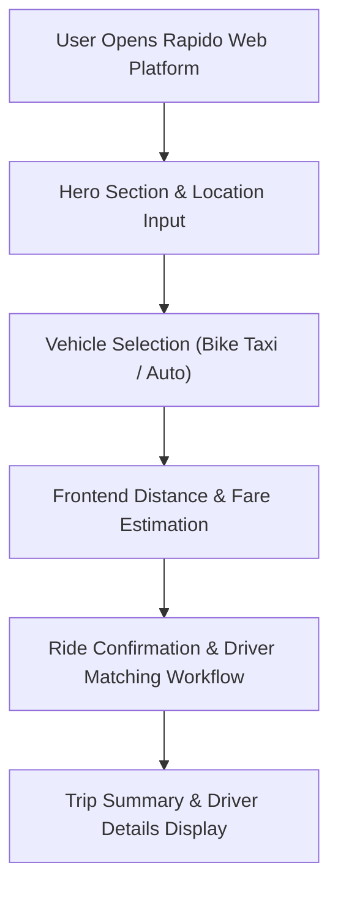

<p align="center">
  
</p>

<p align="center">
  
  
  
  
</p>

<a id="overview"></a>
## 📖 Executive Summary & Overview

Urban micro-mobility and ride-hailing services like Rapido, Uber, and Ola rely on frictionless web and mobile interfaces: location searching, real-time vehicle selection (Bike Taxi, Auto, Cab), transparent fare estimation, and driver dispatching. Replicating this full-stack experience requires responsive layout systems, clear visual branding, and well-organized frontend architectures.

The **Rapido Web Platform** (`Rapido-Web-Site`) is a full-stack web engineering mini-project developed during Semester IV BCA coursework at Alliance University. Documented in `rapido+MINI+PROJECT.pdf`, the project reproduces the Rapido user journey: responsive landing page, service category cards, dynamic fare computation, and responsive mobile-first navigation.

<a id="toc"></a>
## 📑 Table of Contents

- [📖 Executive Summary & Overview](#overview)
- [🎯 Key Features & Capabilities](#features)
- [🏗️ System Architecture & Pipeline](#architecture)
- [🛠️ Tech Stack Breakdown](#tech-stack)
- [⚙️ Reproducible Quickstart & Setup](#setup)
- [📁 Project Directory Layout](#project-layout)
- [👨‍💻 Author & Contributions](#author)

<a id="features"></a>
## 🎯 Key Features & Capabilities

- **Brand-Authentic UI/UX:** Distinctive yellow and charcoal palette reflecting Rapido's visual identity.
- **Service Tier Selection:** Interactive vehicle selection cards (Bike Taxi, Auto, Delivery) with dynamic fare previewing.
- **Location Input Flow:** Pickup and drop-off input fields with simulated route distance and fare estimates.
- **Mobile-First Responsive Layout:** Flexbox and CSS Grid designs adapting smoothly to all screen form factors.

<a id="architecture"></a>
## 🏗️ System Architecture & Pipeline



<a id="tech-stack"></a>
## 🛠️ Tech Stack Breakdown

| Layer | Technologies | Role |
| :--- | :--- | :--- |
| **Frontend Layout** | HTML5 | Semantic structure for booking forms, headers, footers |
| **Visual Styling** | CSS3 | Responsive media queries, flexbox, custom yellow/dark theme |
| **Dynamic Interactions** | JavaScript (ES6) | Fare calculation, form handling, vehicle toggle |
| **Documentation** | Academic Project Report (`.pdf`) | Architecture design, wireframes, and project evaluation |

<a id="setup"></a>
## ⚙️ Reproducible Quickstart & Setup

### Prerequisites
- Modern web browser (Chrome, Edge, Firefox)

```bash
# 1. Clone repository
git clone https://github.com/Amaraiah11/Rapido-Web-Site.git
cd Rapido-Web-Site

# 2. View formal technical project report
# Open 'rapido+MINI+PROJECT.pdf' to review wireframes and architecture
```

<a id="project-layout"></a>
## 📁 Project Directory Layout

```text
Rapido-Web-Site/
├── rapido+MINI+PROJECT.pdf    # Comprehensive academic mini-project report
└── README.md                  # Project overview and system architecture
```

<a id="author"></a>
## 👨‍💻 Author & Contributions

This project is developed and maintained with high technical rigour by **Amaraiah C**, Software Engineer and Data Analytics Practitioner studying Bachelor of Computer Applications (BCA) at Alliance University.

- 🌐 **GitHub:** [@Amaraiah11](https://github.com/Amaraiah11)
- 💼 **LinkedIn:** [Connect on LinkedIn](https://www.linkedin.com/in/amaraiah-c/)
- 📧 **Institutional Contact:** `camaraiahBCA24@ced.alliance.edu.in`

### 🤝 Contribution Guidelines
Contributions, bug reports, and architectural discussions are welcome!
1. **Fork** the repository: `https://github.com/Amaraiah11/Rapido-Web-Site`
2. **Branch**: `git checkout -b feature/your-feature-name`
3. **Commit**: `git commit -m "feat: enhance feature logic"`
4. **Push**: `git push origin feature/your-feature-name`
5. **Open Pull Request** against the `Amaraiah-C` branch.

---

<p align="center">
  <b>⭐ If this codebase or documentation assisted your engineering workflows, please star the repository! ⭐</b>
</p>

<p align="center">
  
</p>
